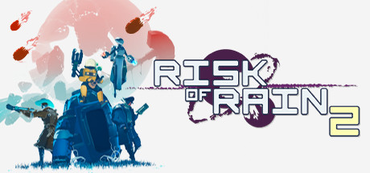

**Risk of Rain 2 is the acclaimed 3D sequel maintaining the original's time-pressure escalation in a third-person action framework. Features 14 survivors, hundreds of stacking items, and runs that can transform into overwhelming chaos with the right combination of unlocks.**

---

## 📖 About

Risk of Rain 2 is the acclaimed 3D sequel maintaining the original's time-pressure escalation in a third-person action framework. Features 14 survivors, hundreds of stacking items, and runs that can transform into overwhelming chaos with the right combination of unlocks.

## ⚠️ Problems Without Trainer

| Problem | Status |
|---------|--------|
| **Eclipse Difficulty** — Eclipse modes add modifiers making already hard runs brutally punishing | ✅ Solved |
| **Item Synergy Knowledge** — Maximizing run potential requires knowing hundreds of item interactions | ✅ Solved |
| **Teleporter Boss** — Teleporter bosses on later loops become enormous damage sponges | ✅ Solved |
| **Void Seeds** — Accessing Void content requires finding specific items and surviving tough encounters | ✅ Solved |

## ✅ Solution

The **Risk of Rain 2 Trainer** solves all these issues by giving you complete control over the game.

## 🎯 Full Feature List

- Unlimited Resources
- God Mode / Invincibility
- Instant Skill Cooldown
- One-Hit Kill
- Freeze Game Timer
- Unlock All Items & Achievements
- Custom Speed Multiplier
- Save State Anywhere

## 🚀 Quick Start

1. **Disable Windows Defender** temporarily (trainer may trigger false positive)
2. Download the trainer from the button above
3. Launch Risk of Rain 2
4. Run the trainer as Administrator
5. Activate desired cheats with hotkeys

## 💎 Free vs Paid

| Feature | Free | Pro |
|---------|------|-----|
| Basic God Mode | ✅ | ✅ |
| Unlimited Resources | ✅ | ✅ |
| All Advanced Cheats | ❌ | ✅ |
| Auto-Updates | ❌ | ✅ |
| Priority Support | ❌ | ✅ |

## 💻 Requirements

- Windows 10/11 (64-bit)
- Risk of Rain 2 (any version)
- .NET Framework 4.8+
- DirectX 11+

## 🍎 macOS

macOS users can use our alternative tool:

## ⚖️ Legal

This trainer is for educational and single-player use only. Use responsibly.

---

